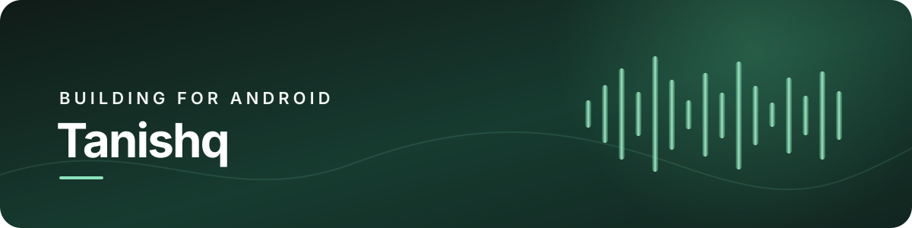

  

### Android developer · Kotlin · Jetpack Compose

I build polished Android apps with a focus on clear interfaces, useful details, and privacy by default.

---

## Current project

### [Adless Streaming](https://github.com/ushin-git/adless-streaming)

An independent Android music player exploring ad-free playback, local libraries, and pluggable music sources. It is an active alpha project.

**Built with:** Kotlin · Jetpack Compose · Media3 · Gradle

## What I care about

- Interfaces that feel calm, fast, and accessible
- Privacy-respecting software with no unnecessary tracking
- Small, maintainable building blocks

## Find me

[GitHub](https://github.com/ushin-git)

---

  Learning by building. Improving one release at a time.

